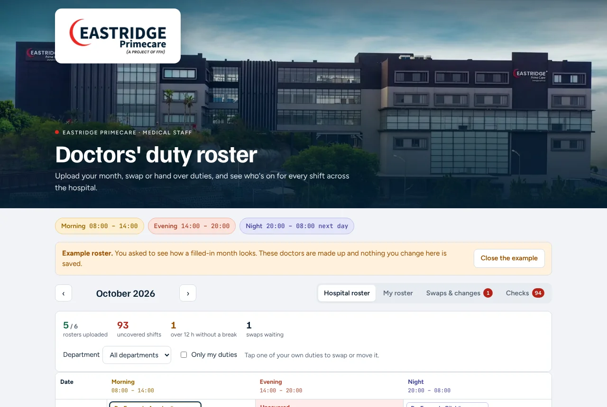
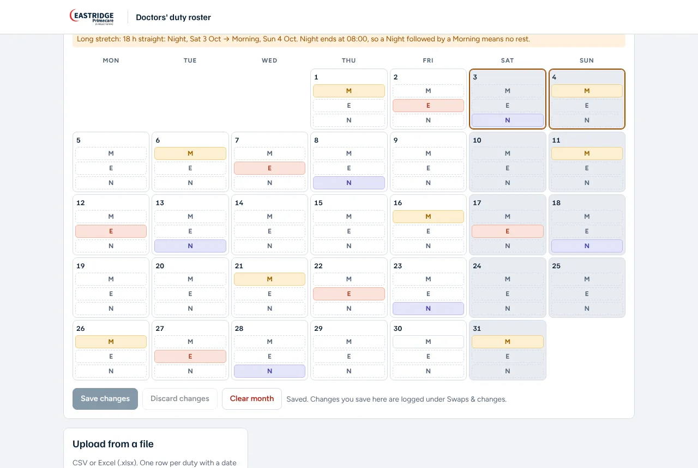
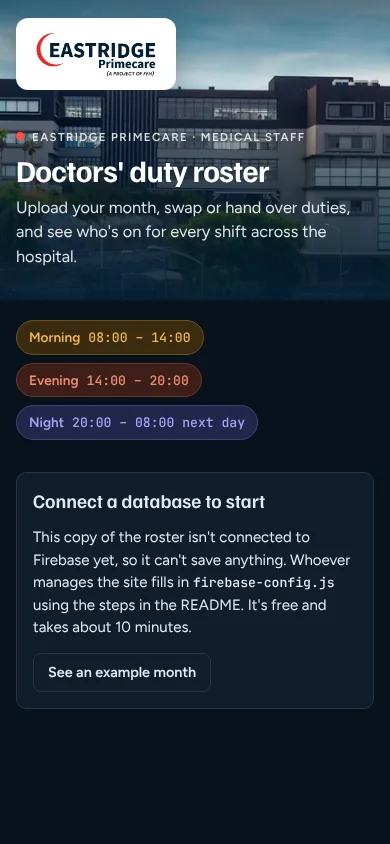

<p align="center"></p>

# Eastridge Primecare Duty Roster


**Live site: <https://eastridgerosters.vercel.app>**

A website where doctors at Eastridge Primecare upload their monthly duty rosters, swap or hand over duties with colleagues, and see which shifts are uncovered. Everything is saved in a free Firebase database, and the site itself is hosted free on Vercel.

## Shifts

| Shift   | Time                    |
|---------|-------------------------|
| Morning | 08:00 – 14:00           |
| Evening | 14:00 – 20:00           |
| Night   | 20:00 – 08:00 next day  |

## What it does

- **Accounts:** doctors create an account with email and password (Google sign-in optional) and add their name, department and phone. A **coordinator approves** each account before they can see or change anything.
- **My roster:** tap M / E / N on a calendar, upload a CSV or Excel (.xlsx) file, or paste rows from a spreadsheet. Dates are read day first (03/11/2026 = 3 November).
- **Swaps & changes:**
  - *Swap with a colleague* or *hand a duty over*: nothing changes until the colleague accepts, then both rosters update.
  - *Move your own duty* to another day or shift: takes effect immediately.
  - Every upload, edit, swap and move is kept in a change log.
- **Hospital roster:** day-by-day board with Morning / Evening / Night columns, filterable by department.
- **Checks:** uncovered shifts per department, anyone on duty more than 12 hours without a break (e.g. Night then Morning = 18 h), and doctors who haven't uploaded.
- **Team** (coordinators only): approve or reject sign-ups, remove access, and mark staff who don't do duties (e.g. MSA) as *not on the duty roster*. They keep access but stay off the board, the checks and swap lists.

## Screenshots

The home page opens with the hospital photo and the full logo:



On the other tabs the logo shrinks into a slim bar that stays at the top:



On a phone, in dark mode:



*Screenshots show the built-in example month; the doctors in them are made up.*

## One-time setup (about 10 minutes, free)

### 1. Create the Firebase project
1. Go to <https://console.firebase.google.com> and click **Create a project** (e.g. `eastridge-rosters`). Google Analytics is not needed.
2. On the project home, click the **Web** icon (`</>`) to add a web app. Give it any nickname; skip Firebase Hosting.
3. Firebase shows a `firebaseConfig` block. Copy those values into **`firebase-config.js`** in this repository, replacing the placeholders.

### 2. Turn on sign-in
1. **Build → Authentication → Get started**.
2. Under **Sign-in method**, enable **Email/Password**.
3. Enable **Google** too (Add new provider → Google → Enable, pick a support email, Save). The "Continue with Google" button is already switched on in `firebase-config.js`.
4. Under **Settings → Authorized domains**, click **Add domain** and add your Vercel address (`eastridgerosters.vercel.app`).

### 3. Create the database and lock it down
1. **Build → Firestore Database → Create database**. Pick a location near you (for Pakistan, e.g. `asia-south1` Mumbai). Start in **production mode**.
2. Open the **Rules** tab, replace everything with the contents of **`firestore.rules`** from this repository, and click **Publish**.

### 4. Put the site online with Vercel (one time)
1. Go to <https://vercel.com/new> and sign in with your GitHub account.
2. Find **Eastridge-Rosters** in the list and click **Import**. (If it isn't listed, click *Adjust GitHub App Permissions* and allow the repository.)
3. Leave every setting as it is (`vercel.json` in this repository already tells Vercel it's a static site) and click **Deploy**.
4. Vercel gives you an address, for this project `https://eastridgerosters.vercel.app`. Add that domain to Firebase's **Authorized domains** (step 2.4).

From then on, every change pushed to `main` goes live by itself in under a minute.

### 5. Make yourself the coordinator
1. Open the site, click **Create an account**, and fill in your details. You'll see **Waiting for approval** and **your user ID**. Copy it.
2. In the Firebase console: **Firestore Database → Data → Start collection**. Collection ID: `admins`. Document ID: *paste your user ID*. Add any field (e.g. `role` = `coordinator`) and **Save**.
3. Reload the site. You're now the coordinator, with a **Team** tab where you approve doctors.
   If you don't do duties yourself, press **Reject** on your own profile in the Team tab so you don't appear on the roster. You stay coordinator.

### 6. Invite the doctors
Send them the site link. Each doctor creates an account, then appears in your **Team** tab to approve.

## Who can do what (enforced by `firestore.rules`)

| | Not approved | Approved doctor | Coordinator |
|---|---|---|---|
| See rosters and the change log | ✗ | ✓ | ✓ |
| Upload / edit rosters, swap, hand over, move | ✗ | ✓ | ✓ (for anyone) |
| Accept or decline a swap | ✗ | only if it was sent to them | ✓ |
| Approve doctors, remove access | ✗ | ✗ | ✓ |
| Make someone a coordinator | ✗ | ✗ | Firebase console only |

Approved doctors can technically write any doctor's roster, because accepting a swap updates both rosters. Every change is recorded in the change log with who made it.

## Files

| File | What it is |
|---|---|
| `index.html` | The whole app (one page, no build step). |
| `vercel.json` | Vercel settings: static site, no build, caching and security headers. |
| `assets/` | Hospital logo, favicon and the hospital photo used on the home page. |
| `docs/` | Screenshots used in this README. |
| `firebase-config.js` | Your Firebase project settings. These values are not secret; access is controlled by the rules. |
| `firestore.rules` | Database security rules. Paste into the Firebase console, or deploy with `npm run deploy:rules`. |
| `tests/rules.test.mjs` | 34 automated checks of the security rules (`npm install && npm run test:rules`, needs Java). |

Before `firebase-config.js` is filled in, the site shows a **Connect a database** screen with an example month you can explore. Nothing is saved there.

## Upload file layouts

One row per duty (two shifts on one day can be written `M+E`):
```
date,shift
01/11/2026,Morning
02/11/2026,Night
05/11/2026,M+E
```

One row per day, mark the shifts:
```
date,morning,evening,night
01/11/2026,X,,
02/11/2026,,,X
```

## Free-tier limits

Firebase's free Spark plan allows 50,000 reads and 20,000 writes per day, which is plenty for a hospital department. No credit card is needed.
